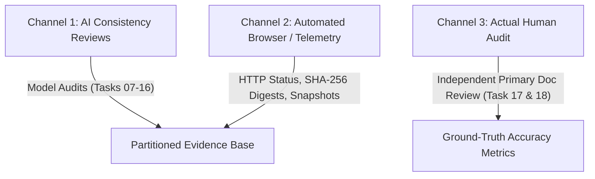

# Task 17 & 18: Human Verification & Remeasurement Protocol

- **Sampling Manifest**: `outputs/task-06/sampling-manifest.json` (`composio-20app-sample-v1`)
- **Scoring Rubric**: `outputs/task-06/evaluation-rubric.md` (v1.1)
- **Pipeline Implementation**: `research_pipeline.py` (v0.2.0), `schemas/record.json` (v1.1), `docs/evidence-rules.md` (v1.1)
- **Sample Scope**: 20 stratified apps across all 10 categories (2 per category), exactly 327 eligible asserted research assertions.
- **Reviewer Attestation**: Strict actual-human attestation (`reviewer_type: "human"`, `--actual-human-attestation`).

---

## 1. Frozen 20-App Sample Denominator

The verification sample was deterministically selected in Task 06 using `stratified-sha256-v1` with seed `composio-eval-2026-11-23-v1` from `data/apps.json` (SHA-256 `6e3aada1...`):

| Category | App ID & Name | Batch Run ID | Eligible Assertions | Basis Split |
| --- | --- | --- | --- | --- |
| **CRM and Sales** | 4. Attio<br>8. Close | `task07-first-pass-003` | 17<br>17 | 15 obs / 2 inf<br>15 obs / 2 inf |
| **Support and Helpdesk** | 16. LiveAgent<br>19. Gorgias | `task08-first-pass-003` | 15<br>16 | 13 obs / 2 inf<br>14 obs / 2 inf |
| **Communications and Messaging** | 21. Slack<br>27. Telegram | `task09-first-pass-004` | 22<br>19 | 20 obs / 2 inf<br>17 obs / 2 inf |
| **Marketing, Ads, Email and Social** | 31. Google Ads<br>40. SendGrid | `task10-first-pass-003` | 20<br>19 | 18 obs / 2 inf<br>17 obs / 2 inf |
| **Ecommerce** | 46. Squarespace<br>50. fanbasis | `task11-first-pass-004` | 15<br>7 | 13 obs / 2 inf<br>5 obs / 2 inf |
| **Data, SEO and Scraping** | 52. SE Ranking<br>60. Clay | `task12-first-pass-005` | 17<br>19 | 15 obs / 2 inf<br>17 obs / 2 inf |
| **Developer, Infra and Data** | 64. Cloudflare<br>65. Supabase | `task13-first-pass-003` | 13<br>15 | 11 obs / 2 inf<br>13 obs / 2 inf |
| **Productivity and Project Mgmt** | 76. Monday.com<br>77. ClickUp | `task14-first-pass-003` | 15<br>13 | 13 obs / 2 inf<br>11 obs / 2 inf |
| **Finance and Fintech** | 83. Binance<br>84. Paygent Connect | `task15-first-pass-002` | 23<br>0 *(unresolved identity)* | 21 obs / 2 inf<br>0 obs / 0 inf |
| **AI, Research and Media-native** | 97. higgsfield<br>98. Mermaid CLI | `task16-first-pass-001` | 22<br>23 | 20 obs / 2 inf<br>20 obs / 3 inf |
| **TOTAL** | **20 apps** | **10 batch runs** | **327 eligible claims** | **290 obs / 37 inf** |

*Note on App 84 (Paygent Connect)*: As specified in `data/apps.json` and `docs/evidence-rules.md`, Paygent Connect is an unresolved identity without primary documentation match. All product claims are preserved as `unknown` with null values. It contributes 0 claims to the asserted denominator and is reported under research coverage unknowns.

---

## 2. Separate Verification Channels

Verification telemetry and scoring are strictly partitioned across three independent channels:



1. **Channel 1 — AI Consistency Review**: Conducted during batch generation in Tasks 07–16 by read-only AI review agents. Labeled `reviewer_type: "ai"`. These checked schema validity, contract bounds, and locator ranges, but **do not establish ground-truth accuracy**. Conclusions from this channel are locked and hidden in the human review packet.
2. **Channel 2 — Automated Browser & Telemetry Checks**: 622 primary documentation snapshots and HTTP fetch logs were captured and hashed. Proves capture integrity and network reachability; does not establish factual correctness.
3. **Channel 3 — Actual Human Audit**: Primary documentary adjudication conducted by an identified person under explicit human attestation. This channel alone establishes the formal baseline accuracy for Task 17 and recheck accuracy for Task 18.

---

## 3. Four-Tier Immutability Architecture

To ensure auditability, artifacts are preserved across four separate immutable tiers:

1. **Tier 1 — Original First-Pass Research**:
   - Stored in sealed batch runs `work/research-runs/task07-first-pass-003/` through `task16-first-pass-001/`.
   - Never modified in place.
2. **Tier 2 — Human Baseline Decisions (Task 17)**:
   - Stored in `outputs/task-17/human-baseline-judgments.json` and sealed child review runs.
   - Captures original answers, human reviewer ID, date, human attestation, and baseline adjudications (`correct`, `incorrect`, `unsupported`, `unresolved`, `not_applicable`).
3. **Tier 3 — Correction History (Task 18)**:
   - Stored in `work/research-runs/task18-corrections-001/` with immutable `changes.json` and `correction_refs` tracking each modified, added, or removed claim with explicit justifications.
4. **Tier 4 — Final Human Recheck Decisions (Task 18)**:
   - Stored in `outputs/task-18/human-recheck-judgments.json` and sealed recheck runs.
   - Documents the human reviewer's evaluation of the corrected claims.

---

## 4. Human Review Instructions (Task 17)

### Step 1: Open the Interactive Review Form
Open `outputs/task-17/human_review_form.html` in any modern web browser:
```text
file:///D:/Composio/outputs/task-17/human_review_form.html
```
*(Alternatively, use `outputs/task-17/human_review_worksheet.md` if reviewing in a text editor).*

### Step 2: Set Reviewer Identity & Attestation
In the sidebar:
1. Enter your name or reviewer identifier (e.g., `human-auditor-1`).
2. Verify the review date.
3. Check the **Actual Human Attestation** box: *"I confirm these adjudications represent real human audit of primary sources."*

### Step 3: Adjudicate Sampled Claims
For each of the 327 claims:
1. Read the claim title, field path, stated scope / context, and first-pass answer.
2. Click the primary documentation link (`source_url`) or expand the local snapshot excerpt to inspect the exact lines cited.
3. Select one adjudication:
   - **`correct`**: All material details hold for the declared scope and are anchored in primary documentation.
   - **`incorrect`**: Contradicted by primary documentation or factually false.
   - **`unsupported`**: Fails to substantiate one or more material details (citation missing, broken scope, edition conflation).
   - **`unresolved`**: Could not be adjudicated due to capture failure (must reference fetch error).
   - **`not_applicable`**: Claim does not apply to the declared scope, backed by evidence.
4. Enter an explanation/reason for your decision.
5. All progress is auto-saved to browser `localStorage` continuously.

### Step 4: Export Judgments
Click **"Export Pipeline JSON"**. Save the exported file to:
```text
D:\Composio\outputs\task-17\human-baseline-judgments.json
```

### Step 5: Run Pipeline Intake
Execute the intake validator from the repository root:
```powershell
.\.venv\Scripts\python.exe tools/intake_human_review.py --input outputs/task-17/human-baseline-judgments.json
```
This validates all adjudications against `schemas/record.json`, enforces human attestation, generates `outputs/task-17/human-baseline-metrics.json`, and outputs the formal baseline report `outputs/task-17/human-baseline-report.md`.

---

## 5. Task 18 Paired Remeasurement Protocol

When Task 18 begins:
1. Research workers will author targeted corrections in immutable child runs referencing the parent claims via `correction_refs`.
2. The human reviewer will re-evaluate the repaired claims.
3. `tools/calculate_comparable_metrics.py` will compute before/after scores on the exact same 327 questions:
   ```powershell
   .\.venv\Scripts\python.exe tools/calculate_comparable_metrics.py --baseline outputs/task-17/human-baseline-judgments.json --recheck outputs/task-18/human-recheck-judgments.json
   ```
4. Required metrics:
   - Evidence-backed accuracy: `C / (C + I + U)` before vs after
   - Scored denominator: `C + I + U` before vs after
   - Review coverage: `(C + I + U) / 327` before vs after
   - Unresolved count before vs after
   - Mandatory disclosure of sample reuse (disclosing that the sample was previously audited).
